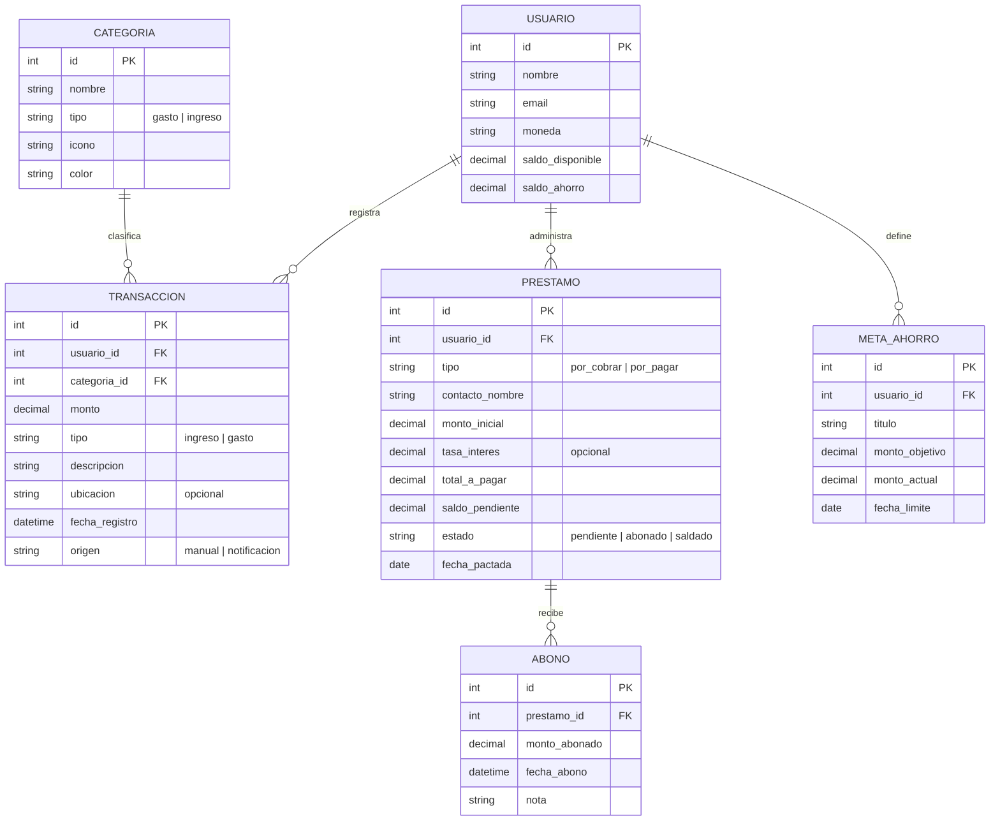

# 💸 Qash — Control Inteligente de Finanzas y Gastos Personales

> **Gestiona tu dinero, proyecta tus ahorros y monitorea tus gastos en tiempo real.**  
> Proyecto desarrollado por **Jose Esneider Covaleda** y **Edwin Esquivel** — Tecnólogo en Análisis y Desarrollo de Software (ADSO).

---

## 📌 Tabla de Contenido
- [Visión General](#-visión-general)
- [Objetivos del Proyecto](#-objetivos-del-proyecto)
- [Funcionalidades Principales](#-funcionalidades-principales)
- [Propuesta de Vinculación de Notificaciones (100% Gratuita)](#-propuesta-de-vinculación-de-notificaciones-100-gratuita)
- [Alcance del Proyecto](#-alcance-del-proyecto)
- [Stack Tecnológico Propuesto](#-stack-tecnológico-propuesto)
- [Modelo de Datos Preliminar](#-modelo-de-datos-preliminar)
- [Estructura del Proyecto](#-estructura-del-proyecto)
- [Backlog y Distribución de Tareas](#-backlog-y-distribución-de-tareas)
- [Flujo de Trabajo y Buenas Prácticas](#-flujo-de-trabajo-y-buenas-prácticas)
- [Autores](#-autores)

---

## 🌟 Visión General

**Qash** es una solución integral orientada a la gestión financiera personal que elimina la fricción del registro manual de gastos mediante automatización y una experiencia visual interactiva. 

El proyecto nace de una necesidad cotidiana: **saber con exactitud cuánto dinero tenemos, en qué se nos va el día a día y cuánto realmente estamos ahorrando**. Qash combina un control estricto de ingresos y egresos con módulos especializados de **préstamos/deudas** (con cálculo de intereses), **metas de ahorro** y una innovadora propuesta de **captura local de notificaciones bancarias** sin costos de suscripción ni pasarelas de pago de terceros.

---

## 🎯 Objetivos del Proyecto

1. **Visibilidad en Tiempo Real:** Ofrecer un panel de control interactivo que refleje el balance disponible, el monto reservado para ahorro y los gastos consolidados.
2. **Registro sin Fricción:** Permitir el registro de transacciones en menos de 5 segundos con campos opcionales y fecha/hora automatizadas.
3. **Gestión de Préstamos:** Administrar cuentas por cobrar y por pagar, diferenciando dinero real disponible de dinero pendiente de devolución.
4. **Automatización Gratuita:** Aprovechar los servicios nativos de accesibilidad/notificaciones del dispositivo móvil para autocompletar transacciones generadas por billeteras digitales y bancos.
5. **Disciplina de Ahorro:** Facilitar la asignación porcentual o fija de ingresos hacia fondos de ahorro o emergencias antes de incurrir en gastos discrecionales.

---

## 🚀 Funcionalidades Principales

### 1. 📊 Inicio Interactivo y Dashboard Dinámico
- **Tarjetas de Balance:** Visualización inmediata de:
  - Saldo Disponible (efectivo / cuentas bancarias).
  - Fondo de Ahorro acumulado.
  - Total gastado en el periodo actual.
- **Gráficos Dinámicos:** Desglose porcentual de gastos por categoría (Alimentación, Transporte, Servicios, Ocio, etc.).
- **Botón de Acción Rápida (FAB):** Acceso inmediato para añadir gasto, ingreso o préstamo con un solo toque.

### 2. 🧾 Registro Ágil de Gastos e Ingresos
- **Monto y Categoría:** Selección rápida de tipo de movimiento y concepto.
- **Ubicación / Comercio (Opcional):** Registro del lugar donde se realizó la compra (ej. "D1", "Supermercado", "SENA").
- **Timestamp Automático:** Fecha y hora capturadas automáticamente con posibilidad de edición manual.
- **Historial Completo:** Listado cronológico de movimientos con búsqueda y filtros por rango de fecha, categoría o método de pago.

### 3. 🤝 Módulo de Préstamos y Cartera
- **Control Dual:** Registro de dinero que prestas (cuentas por cobrar) y dinero que te prestan (deudas).
- **Detalle de la Operación:** Nombre de la persona involucrada, fecha pactada de devolución y observaciones.
- **Cálculo de Interés (Opcional):** Soporte para interés simple (% mensual o monto fijo acordado).
- **Gestión de Estados:**
  - 🟡 *Pendiente* (sin pagos).
  - 🔵 *Abonado* (registro de pagos parciales con historial).
  - 🟢 *Saldado* (deuda liquidada en su totalidad).
- **Regla Contable:** Los cobros pendientes no inflan falsamente el saldo disponible hasta que la devolución se efectivice.

### 4. 💰 Distribución de Ingresos y Ahorro
- **Regla de Asignación:** Al registrar un ingreso, el usuario puede definir qué porcentaje o suma fija va directo al ahorro (ej. 20% ahorro, 80% gasto corriente).
- **Metas de Ahorro:** Creación de objetivos financieros con barra de progreso visual (ej. "Fondo de emergencia", "Meta moto", "Herramientas de estudio").

### 5. 👤 Perfil y Preferencias
- Datos básicos del usuario y configuración de moneda base (COP $ por defecto).
- Gestión y personalización de categorías e íconos.
- Configuración de privacidad (bloqueo por PIN / biometría).
- Exportación local de respaldos (JSON / CSV).

---

## 🔔 Propuesta de Vinculación de Notificaciones (100% Gratuita)

Uno de los principales diferenciales de **Qash** es capturar movimientos bancarios sin pagar APIs corporativas ni servicios de terceros.

### ¿Cómo funciona la arquitectura gratuita?
1. **API Nativa de Android (`NotificationListenerService`):**
   - El sistema operativo Android ofrece un permiso oficial para que una aplicación lea las notificaciones entrantes de apps autorizadas.
   - Es **100% gratuito**, sin requerir planes empresariales ni servidores intermedios.
2. **Privacidad Total (On-Device Processing):**
   - Las notificaciones de apps financieras (ej. Nequi, Daviplata, Bancolombia, etc.) son procesadas localmente en el teléfono mediante **Expresiones Regulares (Regex)**.
   - **Ningún dato confidencial, clave o token sale del dispositivo**.
3. **Flujo de Usuario:**
   ```mermaid
   sequenceDiagram
       autonumber
       participant AppBanco as Billetera / Banco (Nequi/Daviplata)
       participant Android as Android OS (Notificación)
       participant QashListener as Qash Notification Service
       participant User as Usuario

       AppBanco->>Android: Emite alerta ("Enviaste $15.000 a Juan")
       Android->>QashListener: Captura texto del paquete bancario
       QashListener->>QashListener: Aplica Regex (Monto: $15.000, Tipo: Envío)
       QashListener->>User: Muestra alerta interactiva: "¿Registrar gasto de $15.000?"
       User-->>QashListener: Confirma con 1 toque / Asigna categoría
       QashListener->>QashListener: Registra en Historial y descuenta saldo
   ```

---

## 📐 Alcance del Proyecto

```
┌────────────────────────────────────────────────────────────────────────┐
│                                ALCANCE                                 │
├──────────────────┬───────────────────────┬─────────────────────────────┤
│   FASE 1 (MVP)   │   FASE 2 (AUTOMACIÓN) │    FASE 3 (ANALÍTICA & CLOUD│
├──────────────────┼───────────────────────┼─────────────────────────────┤
│ • Dashboard base │ • NotificationListener│ • Estadísticas avanzadas    │
│ • CRUD Gastos/Ing│   para Nequi/Daviplata│ • Proyecciones de ahorro    │
│ • Historial      │ • Regex Parser local  │ • Exportación PDF / Excel   │
│ • Módulo Préstamo│ • Confirmación rápida │ • Copias de seguridad nube  │
│ • Ahorro básico  │ • Categorización auto │ • Soporte multi-cuenta      │
└──────────────────┴───────────────────────┴─────────────────────────────┘
```

---

## 🛠 Stack Tecnológico Propuesto

Para cumplir con el requerimiento de vinculación con notificaciones del teléfono garantizando alto rendimiento y diseño interactivo, se plantean las siguientes alternativas:

| Componente | Opción Recomendada (Híbrida/Móvil) | Alternativa Nativa |
| :--- | :--- | :--- |
| **Frontend Móvil** | **Flutter** (Dart) o **React Native / Expo** | **Android Nativo** (Kotlin + Jetpack Compose) |
| **Listener de Notificaciones** | Plugin nativo Android (`android.service.notification`) | `NotificationListenerService` directo en Kotlin |
| **Almacenamiento Local** | SQLite / Hive / Room Database (Offline-first) | Room Database con SQLite |
| **Estilos & UI** | Material Design 3 / Tailwind-like UI moderna | Material 3 Components |
| **Control de Versiones** | Git + GitHub | Git + GitHub |

> [!TIP]
> Si se desarrolla en **Flutter** o **React Native**, la lógica de notificaciones se implementa a través de un módulo nativo en Android (Java/Kotlin) conectado mediante un canal de eventos (`MethodChannel` o Native Module), lo que permite mantener una interfaz moderna y multiplataforma.

---

## 🗄 Modelo de Datos Preliminar



---

## 📂 Estructura del Proyecto

```
Qash/
├── .github/                  # Plantillas de issues y pull requests
├── docs/                     # Documentación técnica, wireframes y diagramas
│   ├── arquitectura.md
│   └── regex_bancos.md
├── src/                      # Código fuente de la aplicación
│   ├── assets/               # Íconos, imágenes, fuentes
│   ├── components/           # Componentes visuales reutilizables (Botones, Cards, Modales)
│   ├── modules/              # Módulos principales del sistema
│   │   ├── auth/             # Autenticación y perfil
│   │   ├── dashboard/        # Métricas, balances y gráficos
│   │   ├── expenses/         # Gastos e ingresos
│   │   ├── loans/            # Préstamos, intereses y abonos
│   │   ├── savings/          # Metas de ahorro y presupuestos
│   │   └── notifications/    # Servicio de captura y parsing de notificaciones
│   ├── services/             # Lógica de base de datos local y utilidades
│   └── styles/               # Paletas de color, temas y diseño
├── .gitignore
├── LICENSE
└── README.md
```

---

## 📋 Backlog y Distribución de Tareas

A continuación se propone una distribución de módulos para trabajo colaborativo entre **Jose** y **Edwin**:

### 🔹 Módulo A: Núcleo Financiero & Notificaciones
- [ ] Implementación del servicio de escucha de notificaciones (`NotificationListenerService`).
- [ ] Desarrollo de expresiones regulares para parsing de SMS/Push (Nequi, Daviplata, Bancolombia).
- [ ] Lógica contable: saldo disponible, asignación automática de porcentajes de ahorro.
- [ ] CRUD y persistencia de Transacciones (Gastos e Ingresos).

### 🔹 Módulo B: Interfaz Interactiva & Préstamos
- [ ] Diseño y maquetación del Dashboard interactivo (tarjetas dinámicas y gráficos).
- [ ] Módulo completo de Préstamos:
  - Formulario de préstamo (deudor, monto, tasa de interés opcional).
  - Lógica de cálculo de interés y amortizaciones/abonos.
  - Vistas de estado (Pendiente, Abonado, Saldado).
- [ ] Modal de registro rápido (FAB flotante con ubicación opcional y autocompletado de fecha).
- [ ] Pantalla de Metas de Ahorro con progreso visual.

---

## 🤝 Flujo de Trabajo y Buenas Prácticas

1. **Estrategia de Ramas (GitFlow simplificado):**
   - `main`: Código estable y probado para entregas.
   - `develop`: Rama de integración diaria.
   - `feature/<nombre-tarea>`: Ramas independientes para cada funcionalidad (ej. `feature/modulo-prestamos`, `feature/notification-listener`).
2. **Formato de Commits (Conventional Commits):**
   - `feat:` Nueva funcionalidad.
   - `fix:` Corrección de errores.
   - `docs:` Cambios en la documentación.
   - `style:` Cambios visuales o formateo sin alterar lógica.
   - `refactor:` Optimización de código existente.
3. **Pull Requests:** Toda integración a `develop` o `main` debe ser revisada por el otro compañero.

---

## 👥 Autores

- **Jose Esneider Covaleda Hortúa** — [GitHub](https://github.com/covaleda402)
- **Edwin Esquivel** — [GitHub](https://github.com/edwin-esquivel-ADSO)

*Tecnología en Análisis y Desarrollo de Software (ADSO) — SENA*
